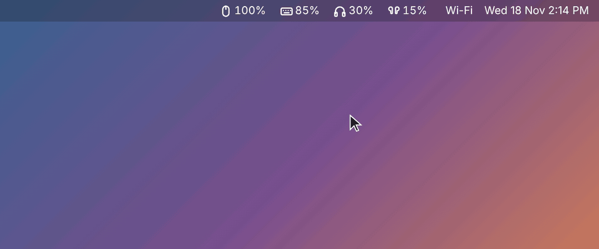

<p align="center">
  
</p>

<h1 align="center">Pips</h1>

<p align="center">
  Bluetooth battery levels for your mouse, keyboard and headphones,<br>right in the macOS menu bar or the Windows taskbar.
</p>

<p align="center">
  <a href="https://github.com/a-mayur/pips/releases/latest"></a>
  <a href="LICENSE"></a>
  
  
</p>

<p align="center">
  <a href="#macos"></a>&nbsp;&nbsp;
  <a href="#windows"></a>
</p>

<table>
  <tr>
    <td width="50%"><b>Only what matters</b><br>One icon and percentage per connected device.</td>
    <td width="50%"><b>Live</b><br>Updates the moment a device connects, disconnects or reports a new level.</td>
  </tr>
  <tr>
    <td><b>Details on click</b><br>Click a device for its name and level; earbuds show left, right and case.</td>
    <td><b>Tiny</b><br>Native app, single binary, no dependencies, near-zero CPU.</td>
  </tr>
</table>

<a name="macos"></a>
<details open>
<summary><b>macOS</b> · menu bar · macOS 13+ · Apple Silicon and Intel</summary>
<br>

<p align="center"></p>
<p align="center"><sub>Click a device for its popover; right-click or Control-click for options. Mockup, device names are examples.</sub></p>

### Install

1. Download `Pips.dmg` from [Releases](https://github.com/a-mayur/pips/releases/latest), open it and drag **Pips** to **Applications**.
2. Open Pips. It is not notarized, so macOS blocks it: go to **System Settings › Privacy & Security** and click **Open Anyway**.
   Or run `xattr -dr com.apple.quarantine /Applications/Pips.app`.
3. Allow Bluetooth access when asked.

### Build from source

Needs Xcode or the Command Line Tools (`xcode-select --install`).

```bash
cd macos && ./build.sh
```

Output in `macos/build/`: `Pips.app`, `Pips.dmg`, `Pips.zip`, `SHA256SUMS.txt`.

> [!NOTE]
> Headphone and earbud battery comes from a private macOS API. If a macOS update removes it, Pips shows an error in the menu and mice and keyboards keep working.

</details>

<a name="windows"></a>
<details open>
<summary><b>Windows</b> · taskbar · Windows 11</summary>
<br>

<p align="center"></p>
<p align="center"><sub>A strip next to the clock. Click a chip for its card; right-click for options. Mockup, device names are examples.</sub></p>

### Install

1. Download `pips.exe` from [Releases](https://github.com/a-mayur/pips/releases/latest) and run it. No installer, no admin rights.
2. If SmartScreen says *Windows protected your PC*, click **More info › Run anyway**. The app is not code-signed.
3. Right-click the strip and turn on **Launch at login** to start it with Windows.

### Build from source

Needs [Rust](https://rustup.rs).

```powershell
cd windows; cargo build --release
```

Output: `windows\target\release\pips.exe`.

> [!NOTE]
> Windows has no official API for taskbar widgets. Like similar tools, the strip floats above the taskbar and follows it. A Windows update that changes the taskbar can misplace it.

</details>

## How it works

| | macOS | Windows |
|---|---|---|
| Mice and keyboards (Bluetooth LE) | CoreBluetooth, Battery Service `0x180F` | Battery level Windows stores per device (`DEVPKEY_Bluetooth_Battery`) |
| Headphones and earbuds | `IOBluetoothDevice` battery properties | Same as above |
| Connect / disconnect | IOBluetooth notifications | Device watcher |

Devices that report no battery level are not shown. Devices on a USB receiver (Logitech Unifying or Bolt) are not Bluetooth and are not supported.

## Release

Every push to `main` builds both apps. Pushing a `v*` tag publishes a GitHub Release with `Pips.dmg`, `Pips.zip`, `pips.exe` and `SHA256SUMS.txt`:

```bash
git tag v1.0.0 && git push origin v1.0.0
```

## License

[GPL-3.0-or-later](LICENSE). Anyone who distributes Pips or a modified version must release its source under the same license.
